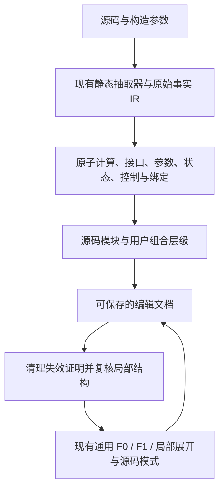

# 通用语义的视图与编辑模式

2026-10-25。通用画布现在可以编辑现有案例，也可以从空白组合模型，然后往返于同一套通用视图。编辑文档保存实际源码 IR 与组合关系；预设不是只有名称和外观的卡片。

## 启动与操作

在 `Summary_Merge` 根目录启动：

```bash
python3 tools/serve_semantic_studio.py --port 8767
```

打开 <http://127.0.0.1:8767/semantic_studio/index.html>，顶部选择“编辑模式”。现有 8766 静态服务也可打开编辑界面，但源码解析与局部认证需要同时运行上述 8767 本地服务。服务仅监听回环地址。

1. 编辑现有模型：选案例 → 编辑模式 → 选模块或逐级进入内部 → 调整参数、源码或连接 → 顶部“视图模式”。原始目录文件不被覆盖，编辑结果另存为文档。
2. 从零搭建：点击“新建空白模型”，加入预设或模型输入/输出，连接输出和输入端口。Shift 多选同级构件后“组合为模块”，可以逐级组合，并“存为预设”供再次实例化。
3. 源码自定义：点击“源码自定义模块”，填写 PyTorch 类或函数、入口及构造参数，解析后保存到用户库，再加入画布。源码只静态解析，不 import 或执行。
4. 参数：源码预设提供构造参数表单，“重新解析并应用参数”会重新抽取底层事实；原始案例算子也可修改 JSON 参数字段，这种直接修改记录为作者声明并保留旧源码来源。
5. 连线：点击输出圆点再点击输入圆点，或使用右侧模块与端口下拉。端口指向真实节点和结果/操作数槽位。已有输入驱动默认拒绝；可以明确勾选替换，也可选择具体边删除或重接。
6. 保存：保存编辑文档得到 `semantic-authoring/1` JSON；从文本或文件导入可以恢复源码、用户库、组合、原始连接与布局。视图的“保存图文档”也包含编辑文档。浏览器 IndexedDB 自动保存不能代替文件备份。

双击模块进入内部，`+ / −` 展开收起，“上一级”返回；键盘 Enter 选择、右方向键进入、Delete 删除、Ctrl/Cmd+Z 撤销。删除支持撤销/重做。切换视图与编辑时保留当前编辑层级。

## 从源码原子到模块，再到视图



`semantic_adapter/authoring.py` 使用原来的 Analyzer、身份与结构认证、局部契约及 schema 校验；临时源码路径转换为 `authoring://module/<source-sha256>/custom_module.py`。完整源码文字与固定构造配置随模块保存，原子节点仍有源码位置和操作数绑定。

`data/semantic/authoring-presets.json` 包含 16 个源码预设、113 个原始单位。默认一级显示 Linear、Attention、Add、Conv2d、CNN、FeedForward、Residual、LayerNorm、Embedding、GRU、Concat；MatMul、ReLU、Softmax、Transpose、Multiply 在默认折叠的原子库。Attention 是 Q/K/V 投影和真实 helper 计算的组合，仍可继续打开。框架 Linear/Conv2d 是当前抽取器粒度上的原子调用，未拆成框架或机器内部实现。

当前案例的所有原始单元，包括接口、参数、状态、条件和未知边界，也可作为构件提取。库和参考清单支持搜索及分批显示，避免默认堆出数千张原子卡片。

`authoring-model.js` 管理节点子树、精确端口、实例身份重映射、组合、删除、源码替换和恢复。组合不压平内部 IR；复用时重映射节点/边及其内部引用。源码替换按同名接口保留外部连接，已连接接口不兼容则整次拒绝。

编辑后 `sourceIR()` 保留原始事实来源，将失效身份、符号值、运行证据等移入历史来源，并清除陈旧语义证书。本地服务只根据当前声明的操作数结构重算局部契约，scope 明确为 `declared user assembly`。这不证明与原 Python 等价、形状兼容或执行覆盖。完全无事实变化的原模型或完整参考重建保留原 IR 及其原证据。

新组装模型有明确根容器，所有根分支都进入通用 publication 投影。编辑 → 视图没有另造预览模板，复用原来的认证展示、F0/F1、展开、布局、路由与质量回退。F1 仍是中间切面。

## 文件职责

| 文件 | 职责 |
|---|---|
| `semantic_adapter/authoring.py` | 静态源码预设、源码解析、组装后局部认证 |
| `tools/serve_semantic_studio.py` | 本地静态服务与独立进程 API；请求大小、CPU、内存和超时限制 |
| `tools/build_authoring_presets.py` | 从源码重新生成预设库 |
| `semantic_studio/authoring-model.js` | 独立可保存编辑文档及源码 IR 映射 |
| `semantic_studio/authoring-app.js`、`authoring.html`、`authoring.css` | 模块库、参数、源码表单、端口、组合和编辑画布 |
| `semantic_studio/app.js`、`index.html` | 双模式入口、同源消息、完整保存与恢复 |
| `tests/authoring.test.cjs`、`tests/test_authoring.py` | 重建、组合、连接、源码替换和证据边界回归 |
| `tools/audit_authoring.cjs` | 直接比较组装事实和原始事实，并审核各投影归属 |

编辑画布复用已有 `SceneClient` worker、`CanvasInteraction.session/constrain/previewRoute`：拖动时只更新受影响图元及轻量路径预览，松开后校验位置和路线，失败恢复。没有修改本轮以前的通用生产布局/路由算法。专用参照编辑器的约束和后台计算迁移背景见 [通用画布交互](generic-canvas-interaction.md)。同级 yWorks 实验是参考公开 demo 行为的自行实现，不能声称商业求解器逐点一致。

端口设计另参考了 [React Flow Handles 官方文档](https://reactflow.dev/learn/customization/handles) 的显式输入/输出、多个唯一端口和动态端口原则；没有引入 React Flow 依赖。

## 验收与证据

| 要求 | 已完成的验证 |
|---|---|
| 源码自定义模块 | 浏览器实际解析 SkipMLP，保存用户库，加入、连接并进入通用视图；测试确认顶层副作用代码没有执行 |
| 原子组合与复用 | 逐级进入真实 Linear/参数/接口；Shift 多选 Linear+Add 组合成 ProjectionAdd 并保存预设，内部边保留 |
| 较大模块优先、原子可选 | 默认 11 个较大模块，另外 5 个原子预设折叠；当前源码原子和完整构件清单可选 |
| 从零重建全部案例 | 43 个目录模型分别按源码构件、逐个原始节点从空白加入，恢复精确边；共 86 次程序化重建 |
| 现有模型和空白模型双向切换 | 浏览器 MLP 的 Linear 128→96 后视图显示 784→96；空白搭建 17 原始单位/13 边后通用视图显示 64→32、32→32，并识别局部残差；切回编辑保留库与下钻位置 |

独立比较直接读取编辑文档的所有节点/边，不只依赖 `sourceIR()` 的 baseline 快捷返回。节点身份、父归属、源码、槽位、条件、参数和运行事实逐字段相等，保存 SHA256；F0/F1/完整源码共 129 个状态检查节点/边归属分区。**43 个案例是程序化逐构件验收，并非人工点击搭建 43 遍，也不是本轮重新审核了 129 张 SVG 的视觉质量。**

实际浏览器还完成了删除 SkipMLP 后 11/7 → 撤销恢复 17/13、自动保存后刷新恢复、保存文本再导入、源码参数重新解析、独立编辑页跳转主视图及同一 iframe 内多次往返。原生下载按钮的浏览器自动化等待超时，因此文件下载落盘不列为已验证项目；保存文本、导入和持久化已实际验证。

全量回归 **102 组、1138 项通过**，测试期间实现和测试文件哈希保持不变。证据：

- [全量测试报告](../verification/authoring/current/test-report.json)
- [43 案例完整事实与投影审核](../verification/authoring/current/assembly-audit.json)
- [浏览器搭建的实际保存文档](../verification/authoring/current/ui-built-document.json)
- [该文档的认证与预览审核](../verification/authoring/current/ui-built-audit.json)
- [该文档重新生成的通用 SVG](../verification/authoring/current/ui-built-preview.svg)
- [真实浏览器操作记录](../verification/authoring/current/ui-receipt.json)
- [最终编辑界面截图](../verification/authoring/current/editor.jpeg)

```bash
python3 tools/run_local_tests.py --out verification/authoring/current
node tools/audit_authoring.cjs
```

## 当前边界

这是源码事实驱动的图编辑与预览，不保证从任意图自动导出可执行 PyTorch，也没有自动验证张量形状、训练或完整程序执行。已有 43 个案例的完整构件清单提供精确重建能力；默认 16 个预设不能独立覆盖所有未知外部算子与运行事实。

大型编辑文档继承现有通用图的布局与展开性能限制；本轮没有新增巨型编辑图的人工交互性能保证。复杂组合在通用视图中仍可能触发原有质量回退。语义图与原始源码文件之间目前是保留来源、重新抽取模块的映射，不会自动回写原 Python 文件。用户组合模块可以导出/导入与复用，但尚没有跨文档统一的外部包管理或参数共享关系编辑面板。
